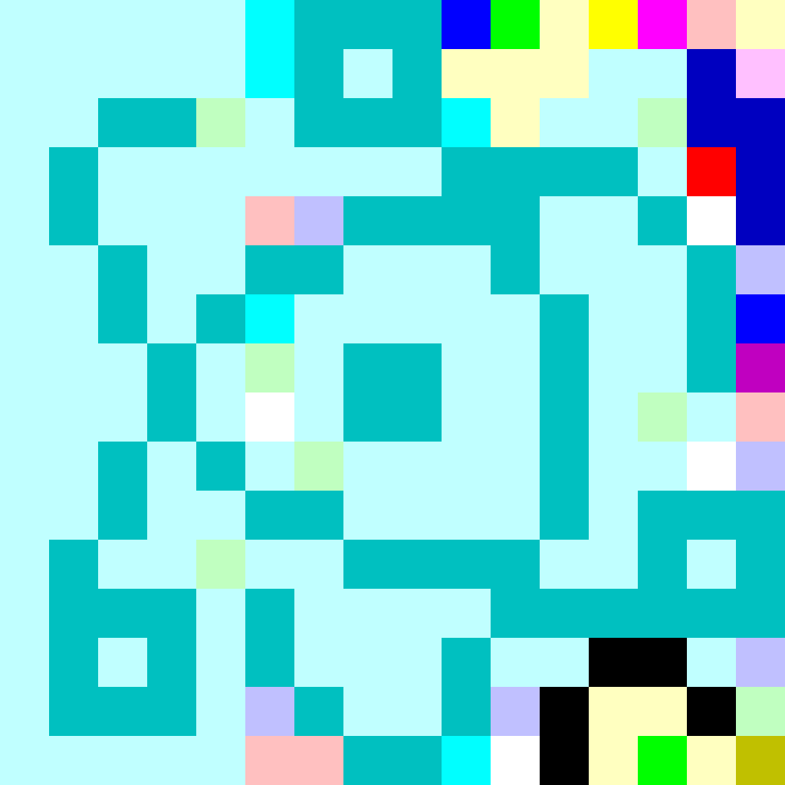
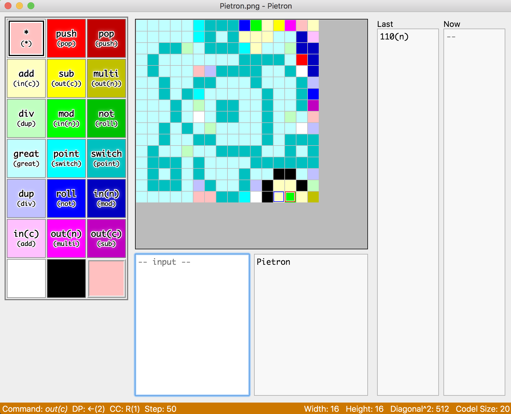

# Pietron

Cross-platform IDE for Piet.

## Overview

Pietron is a cross-platform IDE for editing and debugging the source code of "Piet", an esoteric programming language.

The specification of Piet is [here](https://www.dangermouse.net/esoteric/piet.html).
How the implementation-dependent parts of the specification are handled is described [later](#implementation-details).

Pietron is developed with [Electron](https://electronjs.org/) and named after it.

## Screenshot

## Usage

### Editor

- Draw free lines by dragging on the canvas. 

- Select a color by clicking on the palette and the selected is shown at the bottom-right corner.

- Change the color to draw with by clicking on the palette.

  - The commands are shown in each color on the palette.

  - The bare one is from * (origin) and the parenthesized one is to *.

  - Change the * color by right-cicking on the palette.

- Pick a color by right-clicking on the canvas.

- Change the canvas size in various ways.

  - Change the canvas size one by one with the top-left position fixed with Ctrl + Alt + [↑↓←→] (⌥⌘ on OSX).

    | meaning                   | keyboard shortcut |
    | ------------------------- | ----------------- |
    | extend to the right       | Ctrl + Alt + →    |
    | extend downwards          | Ctrl + Alt + ↓    |
    | trim the rightmost column | Ctrl + Alt + ←    |
    | trim the bottom row       | Ctrl + Alt + ↑    |

  - Change the canvas size one by one with the bottom-right position fixed with Ctrl + Shift + [↑↓←→] (⇧⌘ on OSX).

    | meaning                      | keyboard shortcut |
    | ---------------------------- | ----------------- |
    | shift the image to the right | Ctrl + Shift + →  |
    | shift the image down         | Ctrl + Shift + ↓  |
    | trim the leftmost column     | Ctrl + Shift + ←  |
    | trim the top row             | Ctrl + Shift + ↑  |

  - Change the canvas size to the specified width and height with Ctrl(⌘) + R.

- Undo/Redo support (Ctrl(⌘) + Z / Ctrl + Y (⇧⌘Z)).

- Zoom support (Ctrl(⌘) + ";" / Ctrl(⌘) + "-").

### Debugger

- "Start Debug" executes commands until the program terminates (F5).

  - When the commands are executed over 1,000,000 times, a comfirmation dialog will be displayed.

- "Jump Debug" excutes the specified number of commands (F6).

- "Step Debug" excutes a next command (F7).

- "Stop Debug" stops the execution (ESC).

- While debugging, the source codel and the destination codel are indicated by red and blue borders.

- 🎨Emoji🐛 Support.

### File I/O

- PNG/BMP support.

- Codel size specification support.

- Non piet colors are dealed as white.

## Install

Download zipped files for your operating system from [releases](https://github.com/dnek/pietron/releases).

Executable files are contained in them.

## Author

- **dnek** - *Piet lover* - [dnek](https://github.com/dnek)

## License

This project is licensed under the MIT License - see the [LICENSE](LICENSE) file for details.

## Implementation details

The Piet specification contains some implementation-dependent and recommended parts.
I will describe below how Pietron implements them to the best of my knowledge.

- Colors
  - When opening an image file and importing it into Pietron, non-standard colors are converted to white. Pietron does not handle non-standard colors internally in any other context.

- Maximum stack size
  - The stack is implemented as a JavaScript array, and its maximum length depends on the environment. When it overflows, a [RangeError](https://developer.mozilla.org/docs/Web/JavaScript/Reference/Errors/Invalid_array_length) will occur.

- Maximum integer size
  - Integers are implemented as signed 64-bit integers using [long.js](https://github.com/dcodeIO/long.js). Integer overflow should be handled by wrap around, and commands are not ignored.

- `divide` command
  - When a zero division error occurs, the command is ignored as recommended. Although the result of a division operation is not explicitly defined in the specification, it is implemented as [floored division](https://en.wikipedia.org/wiki/Modulo) to match the `mod` command.

- `mod` command
  - When a zero division error occurs, the command is ignored as recommended.

- `roll` command
  - If the stack size after popping values corresponding to "rolls" and "depth" is less than "depth", the entire command including the first two pops is ignored. As explained in the section on maximum stack size, the stack is supposed to be prevented from exceeding its limit by a RangeError. Therefore, roll commands with a depth exceeding this limit should always be ignored as exceeding the actual stack size.

- `in(number)` command
  - If the entire STDIN matches `/^\s*[+-]?\d+/u`, consume the matched portion and convert the resulting string (with leading whitespace removed) to an integer. The `Long.fromString()` function in [long.js](https://github.com/dcodeIO/long.js) should accept integers exceeding the range of signed 64-bit integers and wrap around, so no exceptions should occur during conversion. If the match fails, the command is ignored according to the specification, and STDIN is not consumed.

- `in(char)` command
  - With STDIN as the string `input`, push `input.codePointAt(0)` (see [String.prototype.codePointAt()](https://developer.mozilla.org/docs/Web/JavaScript/Reference/Global_Objects/String/codePointAt)) onto the stack and consume the corresponding part from STDIN.

- `out(number)` command
  - Print the popped value in decimal notation.

- `out(char)` command
  - If the value at the top of the stack exceeds the range of Unicode code points (0 to 1114111 inclusive), the command is ignored. Otherwise, it is popped and encoded into a Unicode character with that code point.

- Ignored commands
  - When a command is ignored, the state of the stack and STDIN remains intact.

## TODOs

### Notes (December 11, 2025)

Following Pidet and Pietron, I am planning to rebuild a third (and hopefully no further) new IDE from scratch.
The following TODO items may be implemented in it.

- Canvas with HTML `<canvas>`.

- Editor Selection mode.

- Move with arrow keys on the canvas.

- Command preview on the canvas.

- Breakpoint.

- File drag & drop.

- Set the limits of stack.

- Debug log.

## Acknowledgments

- [Pidet](https://github.com/dnek/Pidet) is my previous product and I do not recommend using it.

  - Japanese only.

  - Windows support only.

  - No Emoji support.

  - Not maintained.
